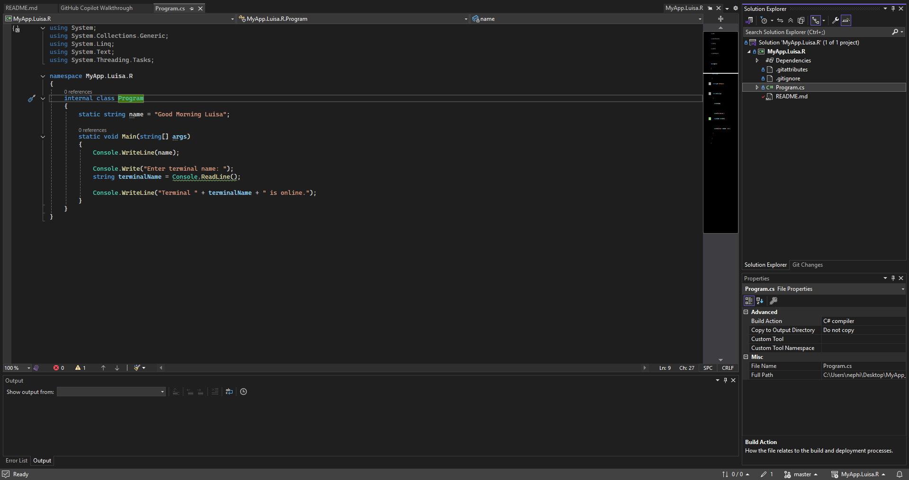
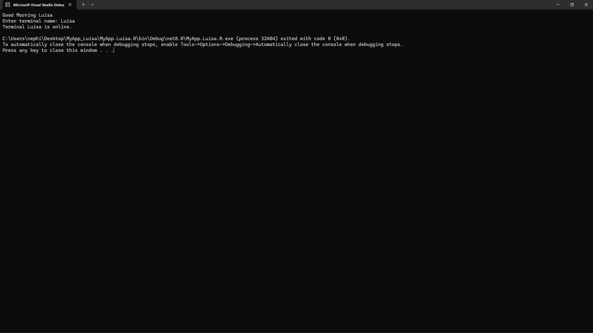

# MyApp Luisa

## Description

This is a C# console application created for the C# tutorial assignment.

The program displays a greeting and performs a terminal status check.

## How to Run

1. Open the project in Visual Studio.
2. Build the project.
3. Run the program.
4. Enter the terminal name when prompted.
5. The program will display the terminal status message.

## Process

I created the C# project in Visual Studio, completed the Hello World tutorial,
added a terminal status check using `Console.ReadLine()`, and tested the program
to make sure it runs without errors.

## Screenshots

### Project in Visual Studio

### Program Running

